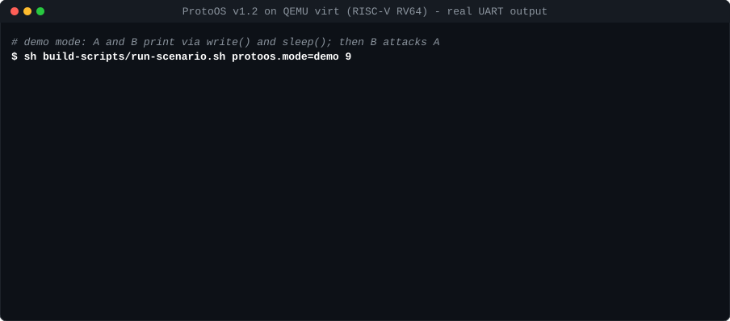

# ProtoOS

[](https://github.com/Intent-Forge/ProtoOS/actions/workflows/acceptance.yml)

An experimental, deliberately minimal but architecturally genuine operating system for **RISC-V RV64**, running on **QEMU `virt`**.

OpenSBI (M-mode) hands over to the ProtoOS kernel (S-mode), which runs two static user processes (U-mode) with their own **Sv39** page tables, **timer-driven preemptive round-robin scheduling** and real `ecall` system calls. It is a teaching/demonstration kernel, not a general-purpose OS.



<sub>Real UART output of the released kernel, captured under QEMU and replayed at a readable pace. Regenerate with `python3 docs/demo/make_demo.py`.</sub>

## Features (v1.0)
- Monolithic kernel, ~1,500 lines of freestanding C11 and RV64 assembly; no libc. ISA: RV64IM + Zicsr + Zifencei, LP64, no floating point.
- **Virtual memory:** three Sv39 roots (kernel, A, B), 4 KiB pages. Kernel pages are mapped with U=0; each process's pages exist only in its own root. Guard pages below the kernel stack and the user stacks.
- **Processes:** exactly two (A = pid 1, B = pid 2), created at boot. States: READY, RUNNING, EXITED, FAULTED.
- **Scheduler:** round robin, 10 ms quantum, preemption by the S-mode timer (SBI TIME). A process that never yields is still preempted.
- **System calls** (`a7` = number, `a0` = argument/result): `exit` (93), `yield` (124), `getpid` (172). Unknown numbers return `-38` and the process continues.
- **Fault isolation:** any other exception from U-mode (page fault, illegal instruction, …) marks only that process FAULTED; the other keeps running. With nothing runnable, the kernel parks safely (timer off, `wfi`).
- **One image for everything:** the same ELF runs the normal mode and every test scenario, selected by `bootargs`.

Architecture, memory map and ABI: [`docs/ARCHITECTURE.md`](docs/ARCHITECTURE.md) ([Russian](docs/ARCHITECTURE_V1_RU.md)). Original frozen specification: [`TECHNICAL_SPECIFICATION_RU.md`](TECHNICAL_SPECIFICATION_RU.md), [`DECISION_REGISTER_RU.md`](DECISION_REGISTER_RU.md).

## What has been verified — and what has not
The acceptance matrix [`ACCEPTANCE_MATRIX.csv`](ACCEPTANCE_MATRIX.csv) has 12 mandatory checks: T1–T7 (S-mode boot, two U-mode contexts, timer preemption, `getpid`/`yield`/`exit`, Sv39 isolation, fault isolation, autonomous normal run) and N1–N5 (cross-process write, user read of kernel memory, privileged instruction from U-mode, unknown syscall, no runnable process).

| Check | Result |
|---|---|
| T1–T7, N1–N5, 3 clean boots each (48 boots), QEMU 10.2.1 + OpenSBI 1.8 + gdb 17.1 | **all PASS** — [`evidence/acceptance/20261011T231210Z/RESULTS.json`](evidence/acceptance/20261011T231210Z/RESULTS.json) |
| Same matrix on OpenSBI 1.4 firmware | **all PASS** — [`evidence/crosscheck-opensbi-1.4/`](evidence/crosscheck-opensbi-1.4/) |
| CI on every push: stock Ubuntu 24.04 runner, QEMU 8.2.2, OpenSBI 1.7, gdb 15 — full matrix ×3 | **all PASS** — see the badge and [Actions](https://github.com/Intent-Forge/ProtoOS/actions/workflows/acceptance.yml) (evidence attached to each run) |
| Rebuild of the ELF on the CI runner and by a second independent reviewer | byte-identical to `release/protoos.elf` |
| Real hardware, other emulators | **not run** |

Evidence is collected from outside the kernel, never from its own messages: the QEMU interrupt trace (`-d int`), GDB (privilege level, CSRs, registers, physical memory, an independent Sv39 page-table walk) and QMP sampling for the normal mode. Every boot directory under `evidence/` holds the exact QEMU command line, raw logs, observations and a per-check verdict. The normal-mode check (T7) is a 3 × 30 s bounded observation (~3,075 timer switches per run), not a proof of unlimited stability.

ELF v1.0: [`release/protoos.elf`](release/protoos.elf), SHA-256 `f1d5a5bca37e00604e8e1c1533db9aee03497c0af7f0055a2d26ade5a9b634ce`.

## Build and run
Tested on Ubuntu 26.04 under WSL2; any recent x86-64 Ubuntu/Debian should work.

```sh
sudo apt install qemu-system-riscv opensbi gdb-multiarch binutils-riscv64-unknown-elf \
                 python3 python3-venv build-essential
sh build-scripts/setup-zig.sh            # pinned Zig 0.13.0 (hash-checked) into ~/.protoos-venv
sh build-scripts/build-wsl.sh            # -> build/protoos.elf + SHA-256
sh build-scripts/run-scenario.sh protoos.mode=normal 10      # normal mode for 10 s
sh build-scripts/run-scenario.sh protoos.test=isolation 3    # A writes into B -> page fault
python3 validation/run_acceptance.py     # full acceptance, 3 clean boots per check (~10 min)
sh build-scripts/host-tests.sh           # host tests: Sv39 table builder, DT parser
```
On older Ubuntu releases QEMU for RISC-V is in `qemu-system-misc`. Other scenarios: `umode`, `preempt`, `getpid`, `yield`, `exit`, `kernel-read`, `fault`, `csr`, `bad-syscall`, `idle`, `idle-fault`.

## Not included (by design)
No shell, file system, networking, drivers beyond the UART, dynamic processes, SMP, POSIX or user-mode floating point.

## How it was made
ProtoOS was built with AI assistance under the direction of the project owner: the specification and earlier stages with OpenAI GPT models, the v1.0 kernel, test harness and release with Anthropic Claude. The owner set the goals and made the decisions; the frozen specification and the decision register record the AI roles as they were at the time.

## License
[GNU Affero General Public License v3.0](LICENSE).

---

## Кратко по-русски
ProtoOS — экспериментальная минимальная ОС для RISC-V RV64 под QEMU `virt`: ядро в S-mode, два процесса в U-mode с отдельными таблицами Sv39, вытеснение по таймеру, системные вызовы `getpid`/`yield`/`exit`, изоляция отказов. Все 12 обязательных проверок (T1–T7, N1–N5) пройдены, по 3 чистых запуска каждая; доказательства получены снаружи (трассы QEMU, GDB) и лежат в `evidence/`. При каждом изменении GitHub Actions заново собирает ОС (ELF побайтно совпадает с выпущенным) и прогоняет всю приёмку на QEMU 8.2.2. Не проверялось: реальное железо. Проект создан с помощью ИИ (GPT, затем Claude) под руководством владельца. Лицензия — AGPL-3.0.
